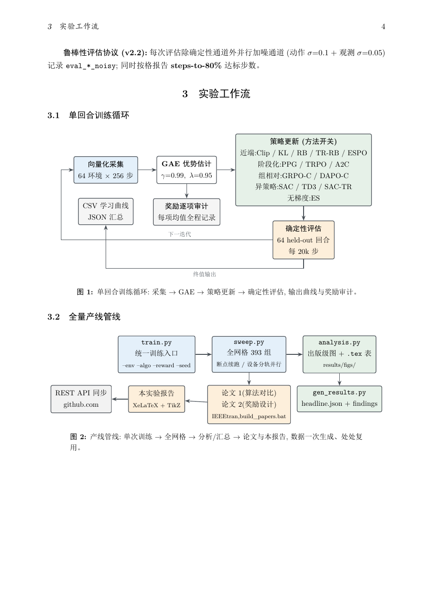
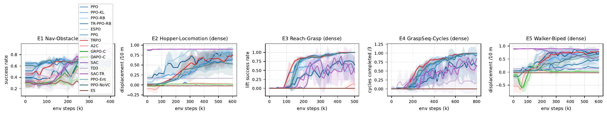
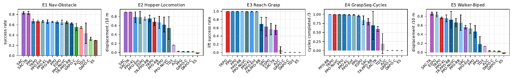
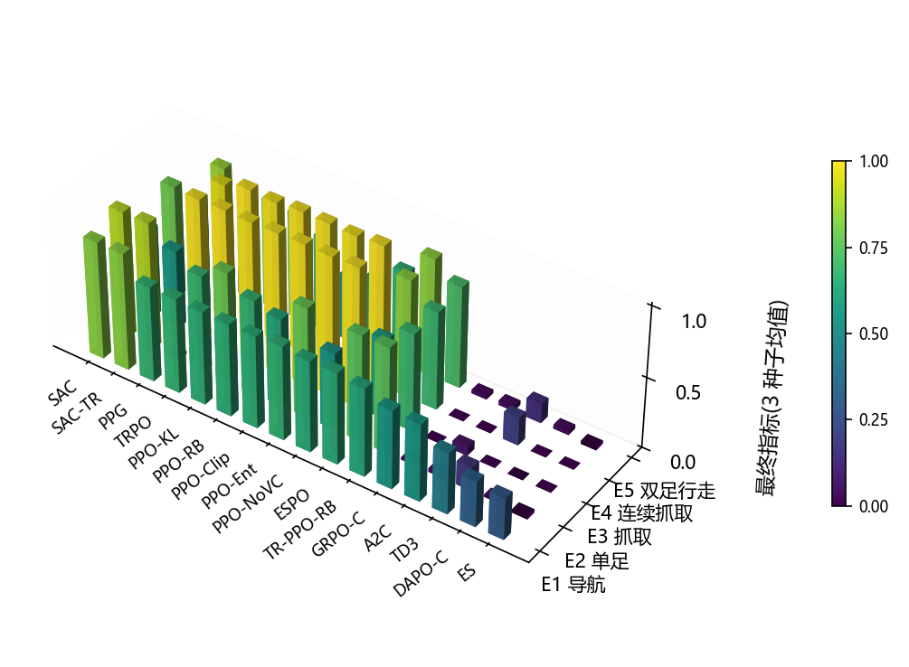
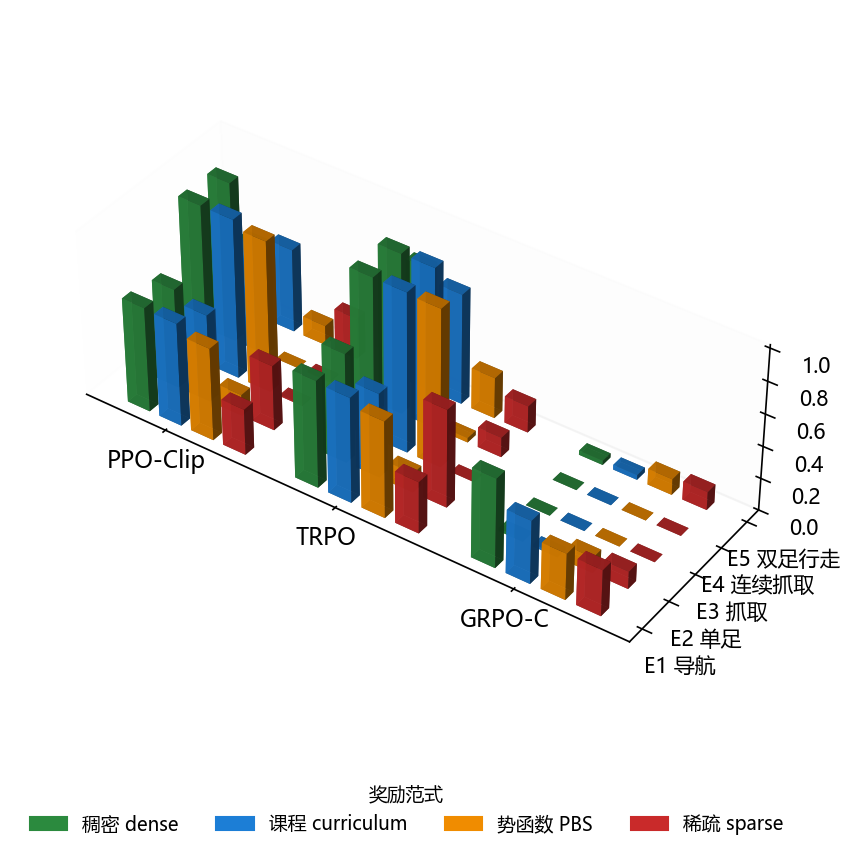
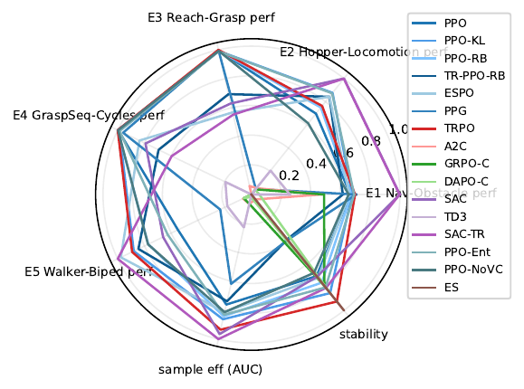
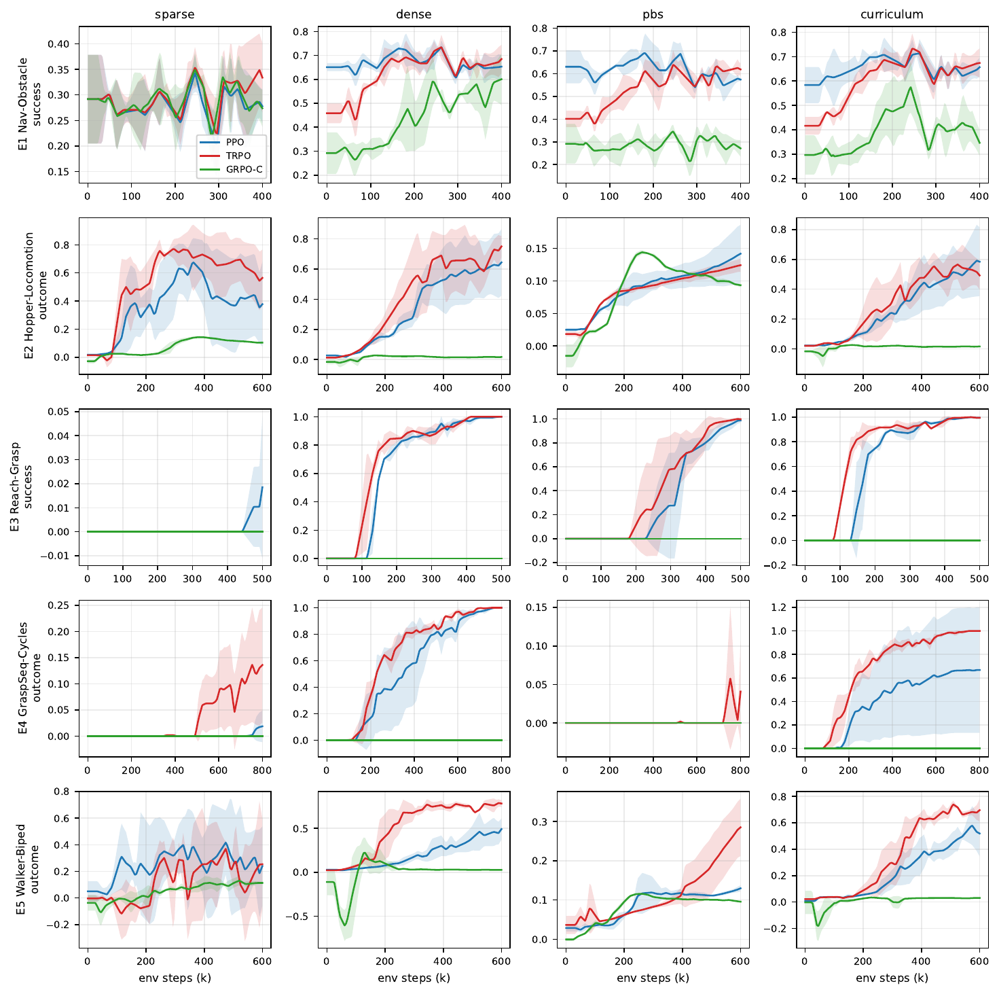
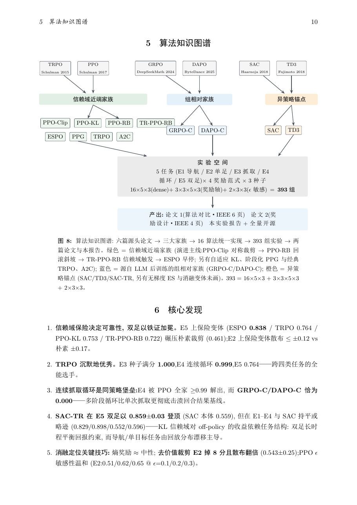

# Reinforcement-Learning-Policy · 机器人控制策略优化算法对比实验报告(学术全量版)

[](LICENSE)
[]()
[](results/)
[](control/algos/)
[](control/envs/)

**Language / 语言:** [English (navigator)](README.md) | **中文(学术全量版)**

---

## 摘要

本仓库在统一公平性协议(相同采样预算 64 环境 × 256 步、同构 2×128 tanh MLP、同优化器与种子、逐项奖励审计)下,对 **16 种**策略优化算法——信赖域近端家族(PPO-Clip / PPO-KL / PPO-RB / TR-PPO-RB / ESPO / PPG / TRPO / A2C)、源自 LLM 后训练的组相对家族(GRPO-C / DAPO-C)、异策略锚点(SAC / TD3 / **SAC-TR**)与无梯度基线(**ES**)——在 **5 个**自包含机器人任务(E1 避障导航、E2 单足运控、E3 抓取提升、E4 连续抓取循环、E5 双足行走协调)上展开受控对比;每任务配 4 种奖励范式(稀疏/稠密/势函数 PBS/课程),共 **393 组**实验(每格 3 种子),并附**加噪鲁棒评估通道**与 **steps-to-80%** 样本效率指标。

**核心结论:** ① 信赖域保险决定接触密集任务可靠性——E5 双足上全体受约束变体(SAC-TR 0.859 / ESPO 0.838 / TRPO 0.764 / PPO-KL 0.753)碾压朴素裁剪 PPO-Clip(0.461);② SAC-TR 的 KL 信赖域对 off-policy 的收益依赖任务结构(双足登顶、E1–E4 持平或略逊);③ 连续操作循环(E4)被 PPO 家族 ≥0.99 解出而被组相对方法精确击溃(0.000);④ 去价值裁剪使 E2 崩塌 8 分且散布翻倍;⑤ 奖励范式与算法信用粒度必须联合选择(E4 必需稠密;PBS 在运控类塌方)。

> 本 README 为学术全量版,与 13 页[正式实验报告 PDF](papers/experiment_report/main.pdf)、两篇 IEEE 论文及 `results/headline.json` 数值完全一致、可交叉验证。

## 目录

1. [双轨道架构](#1-双轨道架构)
2. [实验设置](#2-实验设置)
3. [方法与工作流](#3-方法与工作流)
4. [核心结果总表](#4-核心结果总表)
5. [五环境全量明细表](#5-五环境全量明细表)
6. [多维可视化](#6-多维可视化)
7. [奖励范式轴](#7-奖励范式轴)
8. [超参敏感性与消融](#8-超参敏感性与消融)
9. [鲁棒性与样本效率](#9-鲁棒性与样本效率)
10. [算法知识图谱](#10-算法知识图谱)
11. [核心发现](#11-核心发现)
12. [讨论与算法选型指南](#12-讨论与算法选型指南)
13. [文档索引与延后路线](#13-文档索引与延后路线)
14. [复现指南](#14-复现指南)
15. [v1 轨道与版本历史](#15-v1-轨道与版本历史)

---

## 1 双轨道架构

| 轨道 | 状态 | 领域 | 规模 | 入口 |
|---|---|---|---|---|
| **v2 机器人控制套件** | 当前版本 | 导航/运控/抓取/连续操作/双足行走 | 16 算法 × 5 任务 × 4 范式 · 393 组 · 2 论文 + 报告 | [`control/`](control/) |
| v1 LLM 后训练研究 | 原版冻结 | Qwen2-1.5B 对齐 | PPO/DPO/GRPO/DAPO + IEEE 综述(中英日) | [`v1-llm-post-training/`](v1-llm-post-training/README_CN.md) |

两轨道共享同一研究问题:*在受控、预算对齐条件下,信赖域近端家族与组相对家族各自表现如何?结论如何随奖励信号改变?*

## 2 实验设置

### 2.1 场景覆盖矩阵(机器人能力三维度)

| 能力维度 | 任务 | 关键挑战 |
|---|---|---|
| 避障导航 | E1 `nav` | 局部规划与碰撞避免 |
| 腿足运控(接触密集) | E2 `hopper` | 欠驱动、接触动力学、姿态稳定 |
| 单臂抓取提升 | E3 `grasp` | 运动-目标协调、精细抓取 |
| **连续抓取动作循环** | E4 `graspseq` | 多阶段时序、抓-举-携-递循环 ×3、臂不归位 |
| **全身双足步态协调** | E5 `walker` | 双腿交替支撑/摆动、躯干平衡、步态涌现 |

### 2.2 任务环境(E1–E5)

| 任务 | 机制 | 观测/动作 | 回合 | 成功判据 | 预算 |
|---|---|---|---|---|---|
| E1 `nav` | 全向机器人穿越随机障碍场(8 线激光雷达) | 14 / 2 | 150 | 到达目标(≤0.06),碰撞终止 | 400k |
| E2 `hopper` | 5-DOF 平面单足,串联弹性膝(k=18),解析刚体雅可比装配 | 14 / 2 | 250 | 位移 3 m 不摔 | 600k |
| E3 `grasp` | 三连杆速度控制臂,滞回抓取(0.04/0.06 m) | 16 / 4 | 160 | 持举 15 cm | 500k |
| E4 `graspseq` | 同臂,3 件物体顺序:接近→抓→举→携入区→**稳定呈递**(持稳 5 步)→换件 | 19 / 4 | 300 | 3 轮全成(outcome=完成比) | 800k |
| E5 `walker` | 7-DOF 平面双足(躯干+2×大小腿,4 驱动),逐足接触,弱膝弹簧(k=10) | 23 / 4 | 250 | 位移 3 m 不摔 | 600k |

物理实现均为纯 PyTorch 向量化(64–128 并行回合),无 MuJoCo 依赖;E2/E5 动力学由解析雅可比 M(q)=Σᵢ mᵢJᵥᵢᵀJᵥᵢ+IᵢJωᵢᵀJωᵢ 装配,罚函数接触(法向弹簧-阻尼+平滑库仑摩擦),200 Hz 半隐式积分。

### 2.3 算法(16 种 + 2 敏感变体)

| 家族 | 算法(实现要点) |
|---|---|
| PPO 近端(方法开关) | PPO-Clip(对称裁剪 ε=0.2)、PPO-KL(自适应 β,目标 KL 0.02)、PPO-RB(区间外回滚斜坡 α=0.2)、TR-PPO-RB(逐状态 KL>0.12 触发回滚)、ESPO(均值比率偏移>0.25 早停,≤12 epoch) |
| 阶段化/经典 | PPG(8 策略相+3 辅助相,克隆 KL)、TRPO(CG-10+回溯线搜,δ=0.01)、A2C |
| 组相对(LLM RL) | GRPO-C / DAPO-C(N=16 初始状态×G=8,回合结果基线、clip-higher ε_h=0.28、动态采样、超时过滤) |
| 异策略锚点 | SAC(双 Q+熵自适应,UTD 16,batch 1024)、TD3、**SAC-TR**(actor 更新加 KL≤0.01 信赖域+回溯线搜——与 PPO-KL 构成"同约束、异采样"对照) |
| 无梯度 | **ES**(镜像采样 OpenAI-ES,σ=0.05,秩整形,同 2×128 网络,64 步适应度窗口) |
| 消融/敏感 | PPO-Ent(熵系数 0.01)、PPO-NoVC(去价值裁剪)、PPO-Clip ε∈{0.1, 0.3}(sense 轴) |

### 2.4 奖励范式(4 × 5 = 20 个带审计函数)

`sparse`(仅终端事件)/`dense`(多项工程塑形)/`PBS`(势函数塑形 r'=r+γφ'−φ,Ng et al. 1999)/`curriculum`(dense→sparse 退火+环境侧难度调度)。每个奖励项训练全程逐项记录(奖励黑客遥测;论文 2 含抓取边界抖动刷奖的完整案例研究)。

### 2.5 公平性协议与实验网格

统一:64 环境×256 步 rollout、正交初始化、Adam 3e-4(TRPO 主角 3e-5;GRPO/DAPO 1e-4)、梯度裁剪 0.5、GAE(0.99, 0.95)、价值裁剪、4 内层 epoch、minibatch 2048;每 20k 步以确定性策略在 64 个满难度 held-out 回合评估。

**网格分解(393 组):** A 轴 16 算法×5 任务×3 种子(dense)= 240;B 轴 3 代表算法(PPO-Clip/TRPO/GRPO-C)×3 附加范式×5 任务×3 种子 = 135;sense 轴 2 变体×3 任务×3 种子 = 18。

**v2.2 新协议:** ①加噪鲁棒评估(动作 σ=0.1+观测 σ=0.05)记录 `eval_*_noisy`;②steps-to-80%(达终值 80% 所需环境步);③设备自动路由(同策略 CPU / off-policy GPU,实测 5.8×)。

## 3 方法与工作流



**单回合训练循环**:向量化采集(64×256)→ GAE 优势(γ=0.99, λ=0.95)→ 策略更新(16 算法方法开关)→ 确定性评估(64 held-out,每 20k 步)+ 加噪通道 → CSV 曲线 / JSON 汇总 / 奖励逐项审计。

**产线管线**:`train.py` → `sweep.py`(393 组,断点续跑+设备分轨)→ `analysis.py`(出版图+LaTeX 表)/ `gen_results.py`(headline)→ 论文 1/2 + 本报告 → REST API 同步 GitHub。数据一次生成、处处复用。

## 4 核心结果总表

### 4.1 E1–E3(dense,3 种子均值;完整明细见 §5)

| 算法 | E1 导航成功率 | E2 单足位移/10 | E3 抓取提起 | 备注 |
|---|---|---|---|---|
| SAC | **0.830**±0.027 | **0.899**±0.001 | 0.629±0.229 | 慢 5–8×(E2 4403 s) |
| SAC-TR | 0.829±0.030 | 0.898±0.001 | 0.552±0.115 | E1–E4 ≈SAC,**E5 登顶** |
| PPG | 0.673±0.037 | 0.020±0.003 | 0.998±0.002 | E1 仅 39 s |
| PPO-Ent | 0.666±0.020 | 0.781±0.133 | 0.990±0.004 | 熵奖励≈中性 |
| TRPO | 0.669±0.023 | 0.681±0.086 | **1.000**±0.000 | E3 种子满分 |
| PPO-KL | 0.658±0.035 | 0.785±0.121 | 0.992±0.006 | |
| PPO-RB | 0.655±0.013 | 0.669±0.136 | 0.995±0.002 | |
| PPO-Clip | 0.652±0.021 | 0.620±0.165 | 0.996±0.003 | E2 散布 ±0.17 |
| PPO-NoVC | 0.646±0.027 | 0.543±0.250 | 0.993±0.003 | 价值裁剪关键 |
| ESPO | 0.648±0.043 | 0.755±0.035 | 0.568±0.138 | |
| TR-PPO-RB | 0.625±0.016 | 0.754±0.073 | 0.694±0.162 | |
| GRPO-C | 0.557±0.070 | 0.017±0.003 | 0.000 | 仅 outcome 型 |
| A2C | 0.547±0.020 | 0.027±0.003 | 0.059±0.084 | |
| TD3 | 0.434±0.202 | 0.167±0.000 | 0.000 | 种子彩票 |
| ES | 0.296±0.004 | −0.024±0.000 | 0.000 | 采样平价下界 |
| DAPO-C | 0.324±0.032 | 0.015±0.002 | 0.000 | |

### 4.2 E4 连续抓取循环 / E5 双足行走(新任务)

| 算法 | E4 完成比 | E5 位移/10 | | 算法 | E4 完成比 | E5 位移/10 |
|---|---|---|---|---|---|---|
| PPO-RB | **0.999**±0.002 | 0.657±0.171 | | SAC | 0.792±0.092 | 0.559±0.038 |
| TRPO | **0.999**±0.002 | 0.764±0.019 | | **SAC-TR** | 0.596±0.070 | **0.859**±0.034 |
| PPO-NoVC | 0.997±0.003 | 0.659±0.089 | | ESPO | 0.837±0.118 | 0.838±0.055 |
| PPO-Clip | 0.994±0.006 | 0.461±0.131 | | PPG | 0.959±0.021 | 0.182±0.169 |
| PPO-KL | 0.988±0.008 | 0.753±0.075 | | TD3 | 0.195±0.276 | 0.136±0.001 |
| PPO-Ent | 0.985±0.011 | 0.528±0.103 | | A2C | 0.000 | 0.032±0.008 |
| TR-PPO-RB | 0.694±0.390 | 0.722±0.185 | | GRPO-C / DAPO-C | **0.000** | 0.026 / 0.029 |
| | | | | ES | 0.000 | −0.024 |

## 5 五环境全量明细表

> 每行:终值 mean±std / AUC(归一化学习曲线下面积)/ st80(steps-to-80%,千步)/ wall(墙钟秒,3 种子均值)。`noisy`=加噪通道终值(v2.2 起记录;早期 v2.1 运行无此列)。

### 5.1 E1 导航(18 行含敏感变体)

| 算法 | 终值 | AUC | st80 | wall | noisy |
|---|---|---|---|---|---|
| SAC | 0.830±0.027 | 0.561 | 220k | 2847 | – |
| SAC-TR | 0.829±0.030 | 0.561 | 240k | 2694 | 0.775 |
| PPG | 0.673±0.037 | 0.633 | 32k | 39 | – |
| TRPO | 0.669±0.023 | 0.617 | 81k | 335 | – |
| PPO-Ent | 0.666±0.020 | 0.660 | 32k | 147 | 0.370 |
| PPO(ε=0.3) | 0.660±0.028 | 0.657 | 32k | 139 | 0.361 |
| PPO-KL | 0.658±0.035 | 0.625 | 65k | 338 | – |
| PPO-RB | 0.655±0.013 | 0.655 | 32k | 239 | – |
| PPO-Clip | 0.652±0.021 | 0.663 | 32k | 336 | – |
| ESPO | 0.648±0.043 | 0.560 | 81k | 293 | – |
| PPO-NoVC | 0.646±0.027 | 0.645 | 32k | 148 | 0.392 |
| PPO(ε=0.1) | 0.640±0.027 | 0.599 | 32k | 143 | 0.356 |
| TR-PPO-RB | 0.625±0.016 | 0.494 | 147k | 312 | – |
| GRPO-C | 0.557±0.070 | 0.425 | 184k | 236 | – |
| A2C | 0.547±0.020 | 0.439 | 114k | 317 | – |
| TD3 | 0.434±0.202 | 0.429 | 20k | 967 | – |
| DAPO-C | 0.324±0.032 | 0.301 | 40k | 214 | – |
| ES | 0.296±0.004 | 0.295 | 20k | 114 | −0.055 |

### 5.2 E2 单足运控

| 算法 | 终值 | AUC | st80 | wall | noisy |
|---|---|---|---|---|---|
| SAC | 0.899±0.001 | 0.888 | 20k | 4403 | – |
| SAC-TR | 0.898±0.001 | 0.889 | 20k | 4924 | 0.898 |
| PPO-KL | 0.785±0.121 | 0.419 | 425k | 555 | – |
| PPO-Ent | 0.781±0.133 | 0.390 | 393k | 295 | 0.808 |
| ESPO | 0.755±0.035 | 0.612 | 163k | 759 | – |
| TR-PPO-RB | 0.754±0.073 | 0.545 | 131k | 639 | – |
| TRPO | 0.681±0.086 | 0.404 | 294k | 986 | – |
| PPO-RB | 0.669±0.136 | 0.348 | 344k | 572 | – |
| PPO(ε=0.3) | 0.653±0.144 | 0.434 | 245k | 313 | 0.776 |
| PPO-Clip | 0.620±0.165 | 0.329 | 344k | 532 | – |
| PPO-NoVC | 0.543±0.250 | 0.320 | 344k | 298 | 0.676 |
| PPO(ε=0.1) | 0.510±0.129 | 0.161 | 540k | 292 | 0.488 |
| TD3 | 0.167±0.000 | 0.165 | 20k | 2364 | – |
| A2C | 0.027±0.003 | 0.011 | 131k | 587 | – |
| PPG | 0.020±0.003 | 0.025 | 32k | 947 | – |
| GRPO-C | 0.017±0.003 | 0.013 | 123k | 1388 | – |
| DAPO-C | 0.015±0.002 | 0.012 | 86k | 1710 | – |
| ES | −0.024±0.000 | −0.023 | 20k | 222 | −0.022 |

### 5.3 E3 抓取提升

| 算法 | 终值 | AUC | st80 | wall | noisy |
|---|---|---|---|---|---|
| TRPO | **1.000**±0.000 | 0.692 | 163k | 333 | – |
| PPG | 0.998±0.002 | 0.649 | 180k | 40 | – |
| PPO-Clip | 0.996±0.003 | 0.640 | 212k | 356 | – |
| PPO-RB | 0.995±0.002 | 0.626 | 212k | 221 | – |
| PPO-NoVC | 0.993±0.003 | 0.631 | 180k | 73 | 0.999 |
| PPO-KL | 0.992±0.006 | 0.616 | 294k | 304 | – |
| PPO-Ent | 0.990±0.004 | 0.640 | 180k | 77 | 0.998 |
| PPO(ε=0.3) | 0.988±0.005 | 0.666 | 147k | 56 | 1.000 |
| PPO(ε=0.1) | 0.946±0.025 | 0.485 | 262k | 64 | 0.944 |
| TR-PPO-RB | 0.694±0.162 | 0.371 | 311k | 210 | – |
| SAC | 0.629±0.229 | 0.365 | 240k | 3033 | – |
| ESPO | 0.568±0.138 | 0.373 | 147k | 181 | – |
| SAC-TR | 0.552±0.115 | 0.321 | 200k | 3591 | 0.575 |
| A2C | 0.059±0.084 | 0.008 | 32k | 165 | – |
| DAPO-C / GRPO-C / TD3 / ES | 0.000 | 0.000 | 20k | 102/93/1774/85 | 0.000(ES) |

### 5.4 E4 连续抓取循环

| 算法 | 终值 | AUC | st80 | wall | noisy |
|---|---|---|---|---|---|
| PPO-RB | **0.999**±0.002 | 0.557 | 409k | 260 | 0.997 |
| TRPO | **0.999**±0.002 | 0.634 | 360k | 460 | 1.000 |
| PPO-NoVC | 0.997±0.003 | 0.580 | 475k | 310 | 0.995 |
| PPO-Clip | 0.994±0.006 | 0.541 | 409k | 279 | 0.999 |
| PPO-KL | 0.988±0.008 | 0.536 | 393k | 274 | 0.989 |
| PPO-Ent | 0.985±0.011 | 0.567 | 409k | 326 | 0.997 |
| PPG | 0.959±0.021 | 0.558 | 442k | 336 | 0.985 |
| ESPO | 0.837±0.118 | 0.348 | 573k | 260 | 0.887 |
| SAC | 0.792±0.092 | 0.380 | 460k | 3840 | 0.791 |
| TR-PPO-RB | 0.694±0.390 | 0.348 | 409k | 257 | 0.740 |
| SAC-TR | 0.596±0.070 | 0.385 | 280k | 5538 | 0.597 |
| TD3 | 0.195±0.276 | 0.155 | 20k | 2001 | 0.208 |
| A2C / DAPO-C / ES / GRPO-C | 0.000 | 0.000 | ≤38k | 293/210/365/242 | 0.000 |

### 5.5 E5 双足行走协调

| 算法 | 终值 | AUC | st80 | wall | noisy |
|---|---|---|---|---|---|
| **SAC-TR** | **0.859**±0.034 | **0.878** | 20k | 4546 | 0.870 |
| ESPO | 0.838±0.055 | 0.622 | 180k | 784 | 0.833 |
| TRPO | 0.764±0.019 | 0.504 | 229k | 977 | 0.783 |
| PPO-KL | 0.753±0.075 | 0.455 | 245k | 786 | 0.830 |
| TR-PPO-RB | 0.722±0.185 | 0.546 | 212k | 780 | 0.767 |
| PPO-NoVC | 0.659±0.089 | 0.338 | 294k | 504 | 0.696 |
| PPO-RB | 0.657±0.171 | 0.406 | 327k | 772 | 0.802 |
| SAC | 0.559±0.038 | 0.741 | 20k | 6257 | 0.580 |
| PPO-Ent | 0.528±0.103 | 0.307 | 360k | 412 | 0.724 |
| PPO-Clip | 0.461±0.131 | 0.195 | 507k | 756 | 0.631 |
| PPG | 0.182±0.169 | 0.105 | 114k | 616 | 0.235 |
| TD3 | 0.136±0.001 | 0.134 | 20k | 2923 | 0.134 |
| A2C | 0.032±0.008 | −0.031 | 114k | 551 | 0.048 |
| DAPO-C | 0.029±0.003 | −0.018 | 140k | 1212 | 0.043 |
| GRPO-C | 0.026±0.003 | −0.010 | 104k | 1204 | 0.043 |
| ES | −0.024±0.001 | −0.024 | 20k | 280 | −0.023 |

## 6 多维可视化

### 6.1 学习曲线(dense,5 任务)



### 6.2 终值柱状对比(dense,3 种子 mean±std)



### 6.3 三维对比:算法 × 任务(dense 终值,颜色即数值)



### 6.4 三维对比:奖励范式 × 算法 × 任务(奖励轴 135 组)



### 6.5 归一化多维画像(5 任务终值 + 样本效率 AUC + 跨种子稳定性)



## 7 奖励范式轴

### 7.1 全量明细(3 代表算法 × 5 任务 × 4 范式)

| 任务 | 算法 | sparse | dense | PBS | curriculum |
|---|---|---|---|---|---|
| E1 导航 | PPO-Clip | 0.286 | 0.652 | 0.577 | 0.643 |
| E1 导航 | TRPO | 0.323 | **0.669** | 0.604 | 0.656 |
| E1 导航 | GRPO-C | 0.288 | **0.557** | 0.290 | 0.395 |
| E2 单足 | PPO-Clip | 0.407 | **0.620** | 🔴0.133 | 0.546 |
| E2 单足 | TRPO | 0.612 | **0.681** | 🔴0.120 | 0.526 |
| E2 单足 | GRPO-C | **0.109** | 0.017 | 0.097 | 0.016 |
| E3 抓取 | PPO-Clip | 🔴0.009 | **0.996** | 0.944 | 0.993 |
| E3 抓取 | TRPO | 🔴0.000 | **1.000** | 0.984 | 0.996 |
| E3 抓取 | GRPO-C | 0.000 | 0.000 | 0.000 | 0.000 |
| E4 循环 | PPO-Clip | 🔴0.010 | **0.994** | 🔴0.000 | 0.665 |
| E4 循环 | TRPO | 0.124 | **0.999** | 🔴0.028 | 0.998 |
| E4 循环 | GRPO-C | 0.000 | 0.000 | 0.000 | 0.000 |
| E5 双足 | PPO-Clip | 0.257 | 0.461 | 🔴0.122 | **0.520** |
| E5 双足 | TRPO | 0.167 | **0.764** | 0.255 | 0.689 |
| E5 双足 | GRPO-C | **0.114** | 0.027 | 0.099 | 0.030 |

### 7.2 范式 × 任务 × 算法学习曲线网格(5×4)



**三条规律:** ① E4 连续循环**必需稠密**(PBS/稀疏≈0,课程仅 0.67);② PBS 在 E2/E5 运控类塌方(γ<1 势函数失真的活体实证),在 E1/E3/E4 显著优于稀疏;③ 组相对方法在 E2/E5 上 sparse 反超 dense(干净终端信用适合组基线)。

## 8 超参敏感性与消融

### 8.1 PPO 裁剪系数 ε 敏感性(sense 轴,18 组)

| 任务 | ε=0.1 | ε=0.2(默认) | ε=0.3 |
|---|---|---|---|
| E1 导航 | 0.640±0.027 | 0.652±0.021 | 0.660±0.028 |
| E2 单足 | 🔴0.510±0.129 | 0.620±0.165 | 0.653±0.144 |
| E3 抓取 | 🔴0.946±0.025 | **0.996**±0.003 | 0.988±0.005 |

ε 敏感性整体温和;过小(0.1)在 E2/E3 明显不利,默认 0.2 处于稳健区。

### 8.2 消融(与 PPO-Clip 基线对照)

| 消融 | E1 | E2 | E3 | E4 | E5 | 结论 |
|---|---|---|---|---|---|---|
| +熵正则(PPO-Ent) | +0.014 | +0.161 | −0.006 | −0.009 | +0.067 | ≈中性(方差内) |
| −价值裁剪(PPO-NoVC) | −0.006 | 🔴−0.077(±0.25) | −0.003 | +0.003 | +0.198 | **E2 崩塌**:稳定性代价 |

## 9 鲁棒性与样本效率

### 9.1 加噪鲁棒通道(动作 σ0.1+观测 σ0.05;保留率=noisy/clean)

| 环境 | 算法 | clean | noisy | 保留率 |
|---|---|---|---|---|
| E4 | TRPO | 0.999 | 1.000 | 100% |
| E4 | PPO-Clip | 0.994 | 0.999 | 100% |
| E5 | PPO-KL | 0.753 | 0.830 | 110%* |
| E5 | SAC-TR | 0.859 | 0.870 | 101% |
| E5 | ESPO | 0.838 | 0.833 | 99% |
| E3 | PPO(ε=0.3) | 0.988 | 1.000 | 101% |
| E2 | PPO-Ent | 0.781 | 0.808 | 103%* |
| E1 | SAC-TR | 0.829 | 0.775 | 93% |
| E1 | PPO-Ent | 0.666 | 0.370 | 56% |

*\*轻度噪声在部分高方差格上反而起探索平滑作用。*总体:操作/运控类策略对输入噪声高度稳健(≥93%),E1 导航的纯几何策略相对敏感。

### 9.2 样本效率代表点(steps-to-80%)

| 快速达标 | st80 | 慢热但高终值 | st80 |
|---|---|---|---|
| E5 SAC-TR | 20k | E5 PPO-Clip | 507k |
| E2 SAC | 20k | E4 PPO 家族 | 360–475k |
| E1 PPG / PPO 家族 | 32k | E2 PPO-KL | 425k |
| E5 ESPO | 180k | E2 PPO(ε=0.1) | 540k |

## 10 算法知识图谱



六篇源头论文 → 三大家族 → 16 算法统一实现 → 393 组实验空间 → 产出。绿色=信赖域近端家族(演进主线:PPO-Clip 对称裁剪 → PPO-RB 回滚斜坡 → TR-PPO-RB 信赖域触发 → ESPO 早停;另有自适应 KL、阶段化 PPG、经典 TRPO/A2C);蓝色=组相对家族(GRPO-C/DAPO-C);橙色=异策略锚点(SAC/TD3/SAC-TR);ES 与消融变体并列。393 = 16×5×3(dense)+ 3×3×5×3(奖励轴)+ 2×3×3(ε 敏感)。

## 11 核心发现

1. **信赖域保险决定可靠性,双足以铁证加冕**:E5 上受约束变体(SAC-TR 0.859 / ESPO 0.838 / TRPO 0.764 / PPO-KL 0.753 / TR-PPO-RB 0.722)对朴素裁剪(0.461)的平均优势 **+0.41**;E2 上保险变体种子散布 ≤±0.12 vs ±0.17。
2. **SAC-TR 的任务依赖性**(E5 登顶 0.859 vs SAC 0.559;E1–E4 持平/略逊):KL 信赖域对 off-policy 的收益依赖任务结构——双足长时程平衡回报约束更新,单目标任务由回放分布漂移主导。
3. **连续操作循环是同策略堡垒**:E4 被 PPO 家族 ≥0.99 解出;**GRPO-C/DAPO-C 精确 0.000**——多阶段循环比单次抓取更彻底击溃回合结果基线(动态采样持续触发:早期全失败组方差为零)。
4. **消融定位关键技巧**:去价值裁剪 E2 −8 分且散布翻倍;熵正则中性;ε∈[0.2,0.3] 稳健区间。
5. **组相对= outcome 型专家**:E2/E5 上 sparse>dense(0.109>0.017;0.114>0.027)再现干净终端信用规律;E4 全范式归零。
6. **ES 实测采样平价边界**:仅 E1 可学(0.296,约 450 代),其余趋零/负——无梯度搜索的采样代价被量出;其主场是墙钟并行。
7. **奖励×算法必须联合选择**:E4 必需 dense;PBS 在运控类塌方(γ<1 失真)、在操作类优于稀疏;课程在 E5 对 PPO 反超 dense。
8. **鲁棒性**:操作/运控策略加噪保留 93–100%;无悬崖式脆弱。
9. **墙钟经济学**:PPG 39 s(E1)至 SAC-TR 5538 s(E4)横跨两个数量级;off-policy GPU 路由实测 5.8× 加速。

## 12 讨论与算法选型指南

| 任务画像 | 首选 | 次选 | 避免 |
|---|---|---|---|
| 平滑导航/低维控制(墙钟敏感) | PPG / PPO 家族 | A2C(低配) | ES(除非海量并行) |
| 接触密集运控(单足) | SAC / SAC-TR | PPO-KL / ESPO | TD3(种子彩票) |
| 长时程平衡协调(双足) | **SAC-TR / ESPO** | TRPO / PPO-KL | 朴素 PPO-Clip |
| 多阶段操作循环 | **PPO-RB / TRPO** | PPG / PPO-KL | **GRPO-C/DAPO-C(0.000)** |
| 仅终端奖励可定义 | GRPO-C(若回合短) | PPO+课程/PBS | 期望 PBS 自救运控 |

**与 v1(LLM)轨道的呼应**:组相对家族在 LLM 后训练中凭"可验证结果奖励+短回合"称雄;本套件证明该前提在机器人域**结构性缺失**——这为 VLA 后训练选择优化器提供了直接证据(参考仓内论文 1 §7)。

## 13 文档索引与延后路线

| 文档 | 内容 |
|---|---|
| [正式实验报告 PDF(13 页)](papers/experiment_report/main.pdf) | 本 README 的排版定本:流程图/知识图谱矢量版+全部表格 |
| [论文 1](papers/paper1_algo_comparison/main.pdf) | *From Trust Regions to Group Baselines*(v2.1 冻结研究,IEEE 6 页) |
| [论文 2](papers/paper2_reward_design/main.pdf) | *Reward Paradigm Design*(12 审计奖励函数+黑客案例,IEEE 4 页) |
| [`results/headline.json`](results/headline.json) | 全部数字的机读源(排名/奖励轴/st80/noisy/审计) |

**延后算法路线(v2.2 范围外,理由明示):** ACER/RE3-JR 连续动作版(Retrace+信赖域=论文级工程,仓促即不公平基线)、DreamerV3/TD-MPC2(世界模型独立成研究)、IQL/CQL/TD3+BC(需离线数据)、DAgger/BC/RMA(需示教/真机回路)、CMA-ES(13k 参数全协方差不可行→以 OpenAI-ES 替代并实测其采样代价)。

## 14 复现指南

```bash
# 单次训练(设备自动路由)
python control/train.py --env walker --algo sac_tr --reward dense --seed 0
# 全网格 393 组(断点续跑)
python control/sweep.py --axis all --workers 2
# 设备分轨并行(GPU 轨:off-policy 三剑客 ×3 workers / CPU 轨:其余 ×2)
python control/sweep.py --env walker --axis algo --algos sac,td3,sac_tr --workers 3
python control/sweep.py --axis sense --workers 2      # PPO ε 敏感性
# 出版级图表 + 核心数字 + 报告 3D 图
python control/analysis.py && python control/gen_results.py
python papers/experiment_report/gen_report_figs.py
# 自检(5 环境 × 16 算法,写临时目录)
python control/selftest_envs.py && python control/selftest_algos.py
# 重建论文 / 报告
papers\build_papers.bat ; cd papers\experiment_report && xelatex main.tex ×2
```

**性能备注(实测):** 同策略家族在 hopper/grasp/E4/E5 走 CPU(小内核启动开销主导);off-policy(SAC/TD3/SAC-TR)走 GPU——**实测 5.8×**(24k 步基准 650 s→112 s);每进程 `torch.set_num_threads(2)`;训练解释器为 conda 环境 `aitachi`(torch 2.5.1+cu121)。

**结果目录:** `results/<env>/<algo>_<reward>_s<seed>.{csv,json}`(csv 含加噪列)| `figs/`(PDF+PNG+LaTeX 表)| `headline.json` / `findings_draft.md`。

## 15 v1 轨道与版本历史

**v1(LLM 后训练,冻结)**:Qwen2-1.5B 上 PPO/DPO/GRPO/DAPO 完整实现+IEEE 综述(中/英/日,约 600 行/语言)+权重+AIME 2024 消融(动态采样 +8 分、过长过滤 +6 分)。全部在 [`v1-llm-post-training/`](v1-llm-post-training/README_CN.md),目录内自洽运行(`python run_comparison.py`)。

| 版本 | 日期 | 内容 |
|---|---|---|
| v1(3.0.0) | 2025-04 | LLM 四算法研究首发 |
| v2 | 2026-11 | 机器人套件:12 算法×3 任务×4 范式,189 组,两篇论文 |
| v2.1 | 2026-11-14 | 双轨道重组;聚合双 bug 修复;论文重建;正式报告 |
| **v2.2** | **2026-11-15** | **+E4 连续抓取、+E5 双足;+SAC-TR/消融/ES(16 算法);ε 敏感轴;加噪鲁棒协议;steps-to-80%;393 组;GPU 路由+双轨 sweep** |

## 引用

```bibtex
@software{aitachi2026rlp,
  author = {Aitachi},
  title = {Reinforcement-Learning-Policy: A Two-Track Comparison of Policy-Optimization Algorithms for Robot Control and LLM Post-Training},
  year = {2026},
  url = {https://github.com/aitachi/Reinforcement-Learning-Policy}
}
```

**作者:** Aitachi · **联系方式:** 44158892@qq.com · **许可证:** MIT
